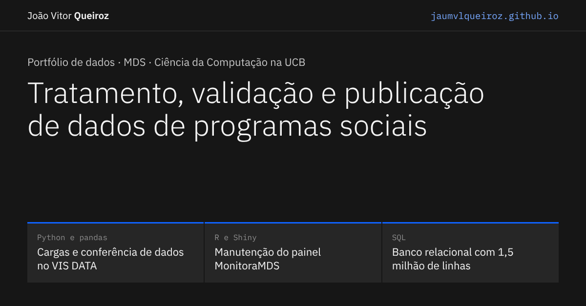

# Portfólio de dados | João Vitor Queiroz



Portfólio do meu trabalho na equipe de dados do Departamento de Gestão da Informação (DGI) do Ministério do Desenvolvimento e Assistência Social (MDS), onde cuido da preparação, da validação e da publicação de dados de programas sociais no VIS DATA e trabalho no painel MonitoraMDS.

**Site:** [jaumvlqueiroz.github.io](https://jaumvlqueiroz.github.io)

## O que o site mostra

Cada seção responde a uma pergunta que um recrutador faria:

| Pergunta | O que tem na seção |
| --- | --- |
| O que você faz no MDS? | Atividades com o que são, como faço, ferramentas, resultado e impacto, e o ciclo de uma carga no VIS DATA |
| Como você trata uma planilha com problemas? | Demonstração interativa de tratamento com pandas, com planilhas fictícias geradas a cada clique |
| E depois de publicar, como você confere? | Simulação da conferência entre a planilha de origem e os dados publicados |
| Como é o seu trabalho em R? | Refatoração de um módulo Shiny em quatro passos, com base em referências de visualização de dados |
| Que tipo de dado passa pelo seu trabalho? | Painel com dados públicos do Bolsa Família por região, estado e mês |
| Você sabe modelar um banco e escrever SQL? | Explorador das consultas do projeto [ecommerce-sql-olist](https://github.com/JaumvlQueiroz/ecommerce-sql-olist), com resultado, SQL e recomendação de negócio |
| Qual é a sua trajetória? | Experiência, formação, outros projetos e ferramentas |

As demonstrações usam dados fictícios ou públicos. Nada vem das bases internas do MDS.

## Tecnologias

HTML, CSS e JavaScript, sem bibliotecas nem etapa de build. Tema claro e escuro, layout responsivo e Content Security Policy sem scripts ou estilos inline.

Acessibilidade: navegação completa pelo teclado, contraste conferido, links sublinhados no texto, alvos de toque de 44 px no celular e informação que nunca depende só da cor. O site foi testado com a verificação automática do axe, sem nenhuma violação, e com simulação de daltonismo (deuteranopia, protanopia e visão sem cor).

## Arquivos

| Arquivo | Conteúdo |
| --- | --- |
| `index.html` | Estrutura e textos da página |
| `estilos.css` | Visual, temas e responsividade |
| `tema.js` | Aplica o tema escolhido antes de a página aparecer |
| `script.js` | Painel do Bolsa Família e demonstração com pandas |
| `navegacao.js` | Destaque da seção atual no menu e acesso por teclado às áreas com rolagem |
| `demonstracoes.js` | Conferência de dados e refatoração em R |
| `sql.js` | Explorador SQL, com os resultados gerados pelo projeto ecommerce-sql-olist |
| `curriculo.pdf` | Currículo para download |
| `og-imagem.png` | Imagem de prévia para LinkedIn e outras redes |

## Como abrir no computador

Baixe o repositório e rode, na pasta dele:

```bash
python -m http.server 8000
```

Depois abra `http://localhost:8000` no navegador.

## Contato

- E-mail: contato.joaovlqueiroz@gmail.com
- LinkedIn: [linkedin.com/in/joaovlqueiroz](https://www.linkedin.com/in/joaovlqueiroz/)
